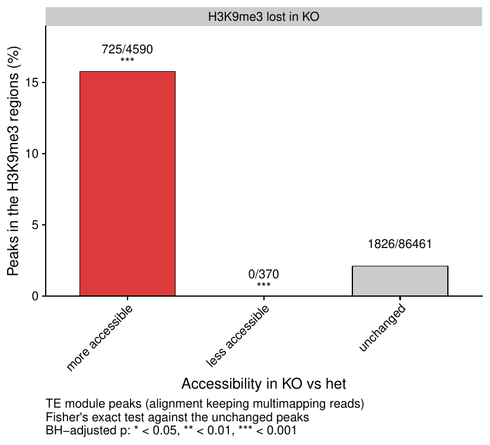
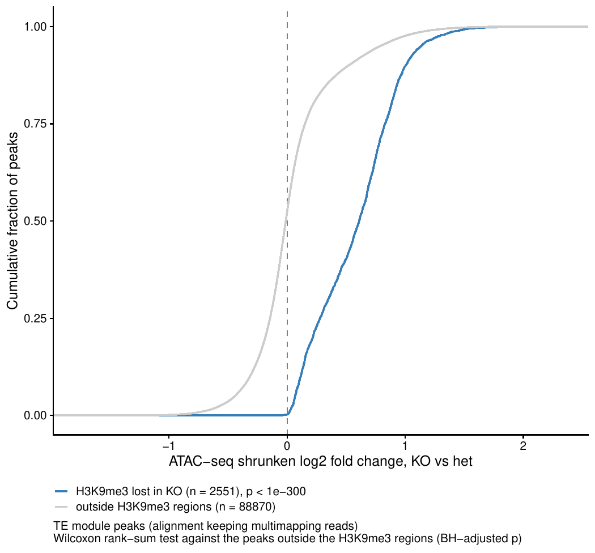
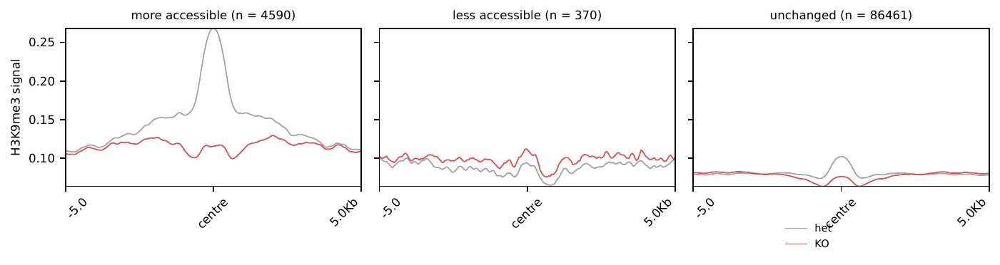
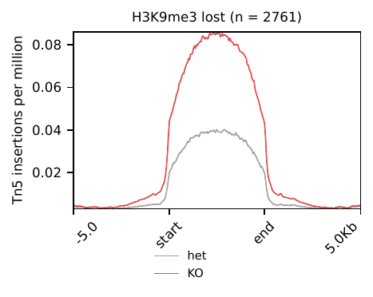
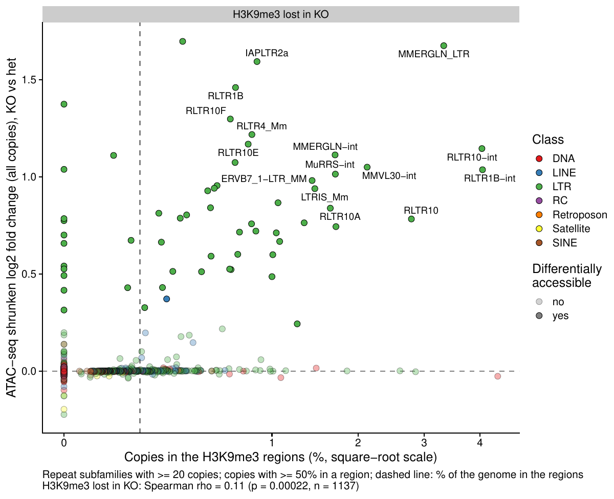
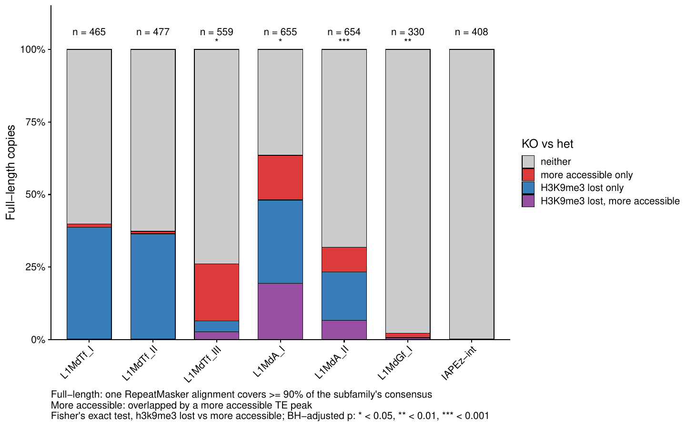

# Integration with H3K9me3

The same analyses are available for DNA methylation; see
[Integration with DNA methylation](methylation_integration.md).

The differential accessibility of a contrast can be compared with the H3K9me3 regions that change
in the same contrast (e.g. CUT&RUN or ChIP-seq of the same conditions). The main question: do
regions that lose H3K9me3 become more accessible, and do the repeats in them open up? This needs
`deseq2: enable: true` and the H3K9me3 data of the contrast in `h3k9me3: contrasts`. It runs for
the ENCODE consensus peaks and, with `te: enable: true`, separately for the peaks of the TE
module, the signal over the H3K9me3 regions and the repeat subfamilies (also with
`te: only: true`).

## Configuration

```yaml
h3k9me3:
  contrasts:
    # DESeq2 contrast of this workflow ({treatment}_vs_{control})
    ko_vs_wt:
      regions: /path/to/ko_vs_wt_h3k9me3.bed
      diffbind: false          # true: regions is a DiffBind results table
      direction: lost          # BED file only: lost or gained in the treatment
      bigwigs:                 # optional
        control: /path/to/wt_h3k9me3.bw
        treatment: /path/to/ko_h3k9me3.bw
  columns:                     # of the DiffBind tables
    chr: seqnames
    start: start
    end: end
    log2fc: Fold
    fdr: FDR
  flip_fold: false
  fdr: 0.05
  profile_flank: 5000         # multiple of the bin size (50 bp, or extra: computematrix --binSize)
  profile_body_length: 5000   # multiple of the bin size
  min_copies: 20
  bigwig_units: signal        # units of the BigWig files (e.g. CPM), for the y axis labels
```

`regions` can be one of two kinds, set with `diffbind`:

- **DiffBind table** (`diffbind: true`): all sites with their log2 fold change and FDR, written
  for example with

  ```r
  dba.show(db, bContrasts = TRUE)  # the number of the KO vs WT contrast, here 1
  report <- dba.report(db, contrast = 1, th = 1, precision = 0)
  write.csv(as.data.frame(report), "ko_vs_wt_h3k9me3.csv")
  ```

  `contrast` selects the contrast that matches the workflow's contrast (without it, DiffBind
  reports the first contrast of `db`). `th = 1` reports all sites, not only the significant ones,
  which are needed as the unchanged background. `precision = 0` keeps the FDR and fold changes
  unrounded, so that a site with FDR 0.0496 is not written as 0.05. The table is tab-separated,
  or comma-separated if the name ends in `.csv`. The starts are 1-based
  (as in DiffBind's GRanges) and are converted to BED. `Fold` must be the log2 fold change of the
  treatment over the control. DiffBind divides the first group of its contrast by the second,
  so set `flip_fold: true` if that was the control. Sites with `FDR < fdr` are **lost** (log2
  fold change below 0) or **gained** (above 0), the others **unchanged**.
- **BED file** (`diffbind: false`): regions that change in one direction, given by `direction`.
  For example, without an IgG control, peaks of the control called with the treatment as the
  MACS2 control (`-c`) are regions with more H3K9me3 in the control than in the treatment,
  so with H3K9me3 lost in the treatment (`direction: lost`). Overlapping regions (e.g.
  consensus peaks of replicates) are merged. There are no fold changes, so there is no
  unchanged group and no fold change scatter plot.

Chromosome names are converted to Ensembl names (`chr1` to `1`, `chrM` to `MT`), and regions on
chromosomes that are not in the genome are removed (listed in the log). The H3K9me3 data must use
the same genome assembly as the ATAC-seq data.

`bigwigs` (optional) are the H3K9me3 signal of the control and the treatment, e.g. the mean of
the replicates (deepTools `bigwigAverage`), for the profiles around the differential peaks.
BigWig files with UCSC chromosome names are fine.

## Analyses

Each peak tested by DESeq2 (with an adjusted p-value) is assigned the H3K9me3 region it overlaps
most (by at least 1 bp) and that region's change: `lost`, `gained`, `unchanged` or `outside` (no
region). The analyses:

1. **Enrichment** (`enrichment.pdf`, `enrichment.tsv`): the percentage of the more, less and
   unchanged accessible peaks that are in regions that lose (and gain) H3K9me3. Fisher's exact
   test compares the more and the less accessible peaks with the unchanged peaks. The tested
   peaks are the background, so the test asks whether peaks that change are in the regions more
   often than other open sites, not more often than random genomic positions (open chromatin
   avoids heterochromatin, which would make a test against the whole genome misleading). If loss
   of H3K9me3 opens chromatin, the more accessible bar in the "lost" panel is the highest.
2. **Distribution** (`distribution.pdf`, `distribution_tests.tsv`): the cumulative distribution
   of the shrunken ATAC-seq log2 fold changes of the peaks by H3K9me3 change, with a Wilcoxon
   rank-sum test of each group against the peaks outside the regions. A curve to the right of
   the "outside" curve means the peaks gain accessibility. This uses all peaks, not only those
   called differential, so it often shows a shift where the enrichment test has too few
   differential peaks.
3. **ATAC-seq signal over the H3K9me3 regions** (TE module, `atac_profile.pdf`,
   `atac_heatmap.pdf`): Tn5 insertions per million (mean of the replicates of each condition, the
   signal tracks of the TE module, scaled as set by `te: bigwig_normalisation`) over the lost, gained and unchanged H3K9me3 regions,
   scaled to `profile_body_length` with `profile_flank` on each side (deepTools computeMatrix
   scale-regions, plotProfile and plotHeatmap). Peaks only count the open sites that were
   called. This shows the accessibility of the whole region, including weak opening spread over
   a broad domain.
4. **Repeat subfamilies** (TE module, `subfamilies/scatter.pdf`, `subfamilies/full_length.pdf`):
   - **Scatter:** for each subfamily with at least `min_copies` copies, the percentage of copies
     with at least half their length in the H3K9me3 regions against the shrunken log2 fold change
     of the insertions in all its copies (`te/deseq2/{contrast}/differential_subfamilies.tsv`),
     with Spearman's rho. The dashed vertical line is the percentage of the genome in the
     regions, as a reference. It is not the percentage of copies expected for random placement,
     which also depends on the lengths of the copies and regions (a copy counts only if at least
     half of it is in one region), so use it as a guide, not a test. Subfamilies that are H3K9me3
     targets and open up are at the top right.
   - **Full-length copies:** the full-length copies of the `te: profile: subfamilies` entries
     (e.g. young L1s), one bar per entry. **Full-length** means that one RepeatMasker alignment
     of the copy covers at least `te: profile: min_consensus_fraction` (default 90%) of its
     subfamily's consensus sequence; see
     [Full-length copies](transposable_elements.md#full-length-copies) for the exact definition
     and its limitations. Each copy is put in one of four groups:
     - **in a region:** the copy is assigned the H3K9me3 region it overlaps most (by ≥ 1 bp;
       `lost`, `gained`, `unchanged` or `outside`), and the plot uses the regions that lose
       H3K9me3 (gain, for a BED file with `direction: gained`);
     - **more accessible:** a more accessible TE peak overlaps the copy (by ≥ 1 bp; TE peaks
       not tested by DESeq2 are left out).

     The bars show the percentage of copies in each combination (in a region and more
     accessible, in a region only, more accessible only, neither), with the number of copies
     above the bar. Fisher's exact test per entry tests whether copies in the regions are more
     (or less) often more accessible than the other copies (2 × 2 table, BH-adjusted). Unlike
     the scatter plot (at least half of a copy in one region), any overlap counts here, because
     full-length copies are long (e.g. about 6 kb for L1) compared with many regions. Without
     `te: profile: subfamilies` the plot says there are no full-length copies.
5. **H3K9me3 signal around the differential peaks** (with `bigwigs`, `signal_profile.pdf`,
   `signal_heatmap.pdf`): H3K9me3 signal of the control and the treatment within `profile_flank`
   of the centre of the more, less and unchanged accessible peaks (computeMatrix
   reference-point; peaks not tested by DESeq2 are left out). This is the reverse of 3: did the sites that open have H3K9me3 in the
   control that is lost in the treatment?
6. **Fold change scatter** (DiffBind tables only, `scatter.pdf`, `correlation.tsv`): the shrunken
   ATAC-seq log2 fold change of each peak in a DiffBind site against the H3K9me3 log2 fold change
   of that site. The numbers in the corners count the pairs significant in both per quadrant: the
   top left (H3K9me3 lost, more accessible) is the expected relationship for a repressive mark.
   Peaks in the same site are not independent, so Spearman's rho of the peaks is given without
   a p-value. The test is per site, with the mean log2 fold change of its peaks (one value per
   site), over all sites and over the sites with a significant change in both (a significant
   H3K9me3 change and at least one differential peak).

p-values of the Fisher's exact and Wilcoxon tests are adjusted (Benjamini-Hochberg) over the tests
of each table.

## Output

In `results/integration/h3k9me3/{contrast}/` (ENCODE consensus peaks) and
`results/te/integration/h3k9me3/{contrast}/peaks/` (TE peaks):

| file                                  | content                                                    |
| ------------------------------------- | ---------------------------------------------------------- |
| `peaks.tsv`                           | per tested peak: ATAC-seq results and the H3K9me3 region it overlaps most (`h3k9me3_region`, `h3k9me3_change`, width, log2 fold change, FDR and overlap in bp) |
| `enrichment.tsv`, `enrichment.pdf`    | percentages of the more, less and unchanged accessible peaks in the lost and gained regions, Fisher's exact tests against the unchanged peaks (odds ratio, 95% confidence interval, p and adjusted p) |
| `distribution.pdf`, `distribution_tests.tsv` | cumulative distributions of the shrunken log2 fold changes by H3K9me3 change, Wilcoxon tests against the peaks outside the regions |
| `scatter.pdf`, `correlation.tsv`      | DiffBind tables only: peak against site log2 fold changes, Spearman correlation of the peaks (descriptive) and of the sites (with p), and the pairs significant in both per quadrant |
| `signal_profile.pdf`, `signal_heatmap.pdf`, `signal_profile.matrix.gz` | with `bigwigs`: H3K9me3 signal around the more, less and unchanged accessible peaks, with the deepTools matrix |

In `results/te/integration/h3k9me3/{contrast}/` (TE module):

| file                                  | content                                                    |
| ------------------------------------- | ---------------------------------------------------------- |
| `atac_profile.pdf`, `atac_heatmap.pdf`, `atac_profile.matrix.gz` | Tn5 insertions per million over the lost, gained and unchanged H3K9me3 regions |
| `subfamilies/copies.tsv`              | per subfamily: number of copies, copies in the lost and gained regions, and the fraction of the genome in those regions |
| `subfamilies/subfamilies.tsv`, `correlation.tsv`, `scatter.pdf` | subfamilies with at least `min_copies` copies and tested by DESeq2: ATAC-seq results and percentages of copies in the regions, Spearman correlation and scatter plot |
| `subfamilies/full_length_copies.tsv`  | each full-length copy of the profile subfamilies with its H3K9me3 change and accessibility (`more accessible`, `less accessible`, `unchanged` or `no peak`, from the TE peaks overlapping it) |
| `subfamilies/full_length.tsv`, `full_length.pdf` | per profile entry: copies by H3K9me3 change and accessibility, Fisher's exact test |

`regions.tsv` (the prepared regions with their change), `decreased.bed` (lost) and
`increased.bed` (gained) are in
`results/integration/h3k9me3/{contrast}/` (in `results/te/integration/h3k9me3/{contrast}/` with
`te: only`). `input_tables/` next to them has an unchanged copy of the `regions` file, so the
results keep the input they were made from. The BigWig files are not copied.

## Example: Morc1 knockout gonocytes

These figures use the Morc1 ATAC-seq data of the
[Transposable elements example](transposable_elements.md#example-morc1-knockout-gonocytes) (TE
module, `KO_vs_het`) and H3K9me3 ChIP-seq of *Morc1* knockout and heterozygous gonocytes from the
same study (GEO [GSE235429](https://www.ncbi.nlm.nih.gov/geo/query/acc.cgi?acc=GSE235429)),
aligned to GRCm39. H3K9me3 broad peaks were called with MACS2 (FDR 0.1) in the heterozygous
samples with the knockout as control, so the 2,848 consensus peaks (2,761 after merging
overlapping peaks) are regions with H3K9me3 in the heterozygous gonocytes that is lost in the
knockout. They are a BED file, so there are no unchanged or gained regions and no fold change
scatter:

```yaml
h3k9me3:
  contrasts:
    KO_vs_het:
      regions: /path/to/H3K9me3_het_over_KO_peaks.bed
      diffbind: false
      direction: lost
      bigwigs:
        control: /path/to/H3K9me3_het.bw
        treatment: /path/to/H3K9me3_KO.bw
  bigwig_units: CPM
```

### TE peaks



**Enrichment** (`peaks/enrichment.pdf`): 15.8% of the more accessible TE peaks (725 of 4,590) are
in regions that lose H3K9me3, against 2.1% of the unchanged peaks (odds ratio 8.7). None of the
370 less accessible peaks are.



**Distribution** (`peaks/distribution.pdf`): almost all 2,551 TE peaks in the regions that lose
H3K9me3 gain accessibility (median shrunken log2 fold change 0.61, against −0.01 for the peaks
outside the regions), not only the peaks called differential.



**H3K9me3 around the differential peaks** (`peaks/signal_profile.pdf`): the more accessible peaks
have H3K9me3 at their centre in the heterozygous gonocytes (grey), and it is gone in the knockout
(red). The less accessible and unchanged peaks have little H3K9me3 in either.



**ATAC-seq over the regions** (`atac_profile.pdf`): over the whole regions that lose H3K9me3,
the knockout has about twice as many Tn5 insertions per million as the heterozygous gonocytes.

### Repeat subfamilies



**Scatter** (`subfamilies/scatter.pdf`): the subfamilies that open (solid points) are LTR
retrotransposons, and most of them have a larger percentage of their copies in the regions that
lose H3K9me3 than the genome (dashed line), e.g. MMERGLN_LTR, RLTR10-int and RLTR1B-int with
3–4%. Most subfamilies have no copies in the regions, so Spearman's rho over all 1,137
subfamilies is low (0.11).



**Full-length copies** (`subfamilies/full_length.pdf`): 36–48% of the full-length L1MdTf_I,
L1MdTf_II and L1MdA_I copies are in regions that lose H3K9me3. Copies in these regions are more
often more accessible for L1MdTf_III, L1MdA_I, L1MdA_II and L1MdGf_I (e.g. L1MdA_I: 127 of 315
copies in the regions against 101 of 340 others; odds ratio 1.6, adjusted p = 0.01). Few
L1MdTf_I and L1MdTf_II copies overlap a more accessible TE peak (6 and 5), although their 5' ends
open on average ([TE profile](transposable_elements.md#morc1-full-length-copies)): their copies are so
similar that most reads are multimappers, which are spread over the copies, so the signal at
single copies is often too low to call a peak.

## Caveats

- **Peaks called against the other condition:** without an IgG or input control, peaks of one
  condition called over the other are the regions with more signal in that condition. They are
  differential regions without a statistical test of the replicates, so their number depends on
  the peak caller's threshold. With replicates of both conditions, a DiffBind analysis gives
  fold changes and FDRs and the unchanged regions as background.
- **Broad domains:** H3K9me3 domains are often several kb wide, and a peak in a domain is not
  necessarily where H3K9me3 changes most. The profiles (3 and 5) show the signal at both scales.
- **Repeats and mappability:** H3K9me3 is enriched on young repeats, whose reads align to many
  places. Use the TE module peaks and subfamilies for those. The ENCODE consensus peaks are
  depleted in young repeats (see [Transposable elements](transposable_elements.md#caveats)).
  The H3K9me3 data has the same problem, depending on how its multimapping reads were handled.
