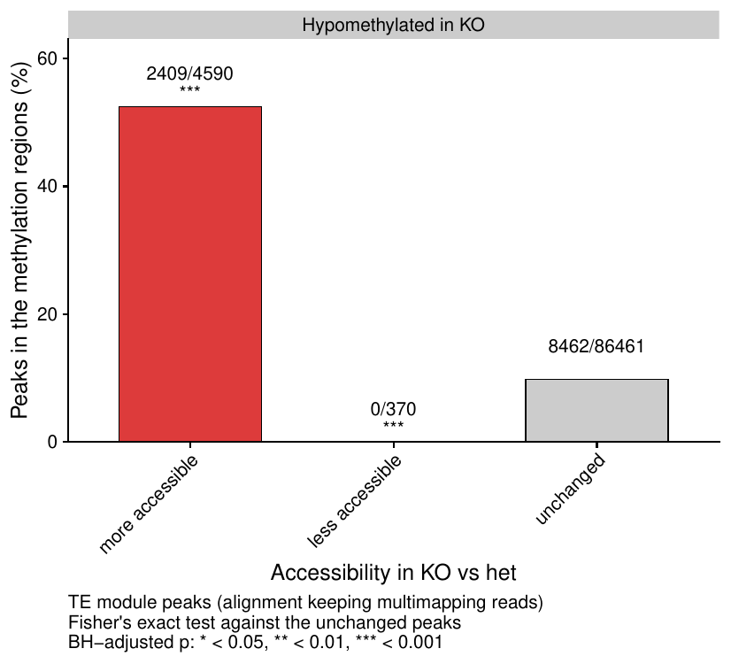

# Integration with DNA methylation

The differential accessibility of a contrast can be compared with the differentially methylated
regions (DMRs) of the same contrast, from EM-seq or bisulfite sequencing. The main questions: do
regions that lose methylation become more accessible, and do the repeats in them open up? This
needs `deseq2: enable: true` and the DMRs of the contrast in `methylation: contrasts`.

The analyses and figures are the same as for H3K9me3, with the DMRs as regions:
**hypomethylated** in the treatment where H3K9me3 is **lost**, **hypermethylated** where it is
**gained**. See [Integration with H3K9me3](h3k9me3_integration.md#analyses) for what each
figure shows and how it is tested. This page describes what differs.

## Configuration

```yaml
methylation:
  contrasts:
    # DESeq2 contrast of this workflow ({treatment}_vs_{control})
    ko_vs_wt:
      regions: /path/to/ko_vs_wt_hypomethylated_dmrs.bed
      methylkit: false         # true: regions is a methylKit results table
      direction: hypo          # BED file only: hypo or hyper in the treatment
      bigwigs:                 # optional: CpG methylation (%)
        control: /path/to/wt_methylation.bw
        treatment: /path/to/ko_methylation.bw
  columns:                     # of the methylKit tables
    chr: chr
    start: start
    end: end
    diff: meth.diff
    fdr: qvalue
  flip_diff: false
  fdr: 0.01
  min_diff: 25                 # percentage points
  profile_flank: 5000          # multiple of the bin size (50 bp, or extra: computematrix --binSize)
  profile_body_length: 5000    # multiple of the bin size
  min_copies: 20
```

`regions` can be one of two kinds, set with `methylkit`:

- **methylKit table** (`methylkit: true`): all tested regions (e.g. 1 kb tiles) with their
  methylation difference and q-value, written for example with

  ```r
  diff <- calculateDiffMeth(meth_tiles)
  write.csv(getData(diff), "ko_vs_wt_methylkit.csv", row.names = FALSE)
  ```

  All tested regions are needed, not only the DMRs (`getMethylDiff()`), as they are the
  unchanged background. The table is tab-separated, or comma-separated if the name ends in
  `.csv`. The starts are 1-based (as in methylKit) and are converted to BED. `meth.diff` must be
  the methylation of the treatment minus the control, in percentage points. methylKit subtracts
  the group with `treatment = 0` from the group with `treatment = 1`, so set
  `flip_diff: true` if the control was 1. Regions with `qvalue < fdr` and
  `|meth.diff| > min_diff` are **hypo**methylated (below 0) or **hyper**methylated (above 0), the
  others **unchanged**. Rows without a q-value or methylation difference are removed (counted in
  the log), as they have no test result. The defaults (q < 0.01, 25 percentage points) are common methylKit
  thresholds. Other tools (e.g. DSS) work if their table has the same kind of columns
  (`columns`).
- **BED file** (`methylkit: false`): DMRs that change in one direction, given by `direction`,
  e.g. the hypomethylated tiles of a methylKit analysis. Overlapping DMRs are merged, but
  adjacent ones (e.g. neighbouring 1 kb tiles) are not, so merge those first if they should count
  as one region (`bedtools merge -d 0`). There are no methylation differences, so there is no
  unchanged group and no scatter plot.

Chromosome names are converted to Ensembl names (`chr1` to `1`), and regions outside the genome
are removed (listed in the log). The methylation data must use the same genome assembly as the
ATAC-seq data.

`bigwigs` (optional) are the CpG methylation (%, 0 to 100) of the control and the treatment, e.g.
the mean of the replicates. They give the profiles of methylation around the more, less and
unchanged accessible peaks (`signal_profile.pdf`, `signal_heatmap.pdf`).

## Differences from H3K9me3

- **Methylation profiles:** methylation is only defined at CpGs, so bins without a CpG are left
  out of the mean (missing), not counted as 0% as for coverage signals. Regions with few CpGs
  give noisy profiles.
- **Effect size:** the scatter plot (methylKit tables) has the methylation difference in
  percentage points on the x axis, not a log2 fold change. As for DiffBind sites, the test is per
  tested region, with the mean log2 fold change of its peaks.
- **Tiles:** methylKit tiles have a fixed width, so a tile that only partly covers a peak still
  counts as overlapping it. For the repeat subfamilies, a copy counts as in a DMR if at least
  half of it is in one region, so long copies (e.g. full-length L1s, about 6 kb) are only
  counted if adjacent tiles were merged into one region. The full-length copies in
  `full_length.pdf` are the exception: they are assigned the region they overlap most by any
  overlap (≥ 1 bp), and the plot uses the hypomethylated regions (or the BED regions). Full-length
  is defined in [Full-length copies](transposable_elements.md#full-length-copies) (one
  RepeatMasker alignment covering at least 90% of the subfamily's consensus by default).

## Output

The same files as for H3K9me3 (see [the H3K9me3 output](h3k9me3_integration.md#output)), in
`results/integration/methylation/{contrast}/` (consensus peaks) and
`results/te/integration/methylation/{contrast}/` (TE module). The columns of the region of each
peak start with `methylation_` (`methylation_change`: `hypo`, `hyper`, `unchanged` or
`outside`; `methylation_meth_diff`, `methylation_FDR`). The subfamily tables count the copies in
hypo- and hypermethylated regions (`n_copies_hypo`, `n_copies_hyper`). `decreased.bed`
(hypomethylated) and `increased.bed` (hypermethylated) are next to `regions.tsv`, and
`input_tables/` has an unchanged copy of the `regions` file.

## Example: Morc1 knockout gonocytes

These figures show the output of the integration on public data of *Morc1* knockout and
heterozygous gonocytes: the ATAC-seq data of the
[Transposable elements example](transposable_elements.md#example-morc1-knockout-gonocytes) (TE
module, `KO_vs_het`; [Uneme et al., 2024](https://doi.org/10.1073/pnas.2317095121)) and DNA methylation data of *Morc1* knockout and heterozygous germ
cells ([Pastor et al., 2014](https://doi.org/10.1038/ncomms6795); GEO [GSE63048](https://www.ncbi.nlm.nih.gov/geo/query/acc.cgi?acc=GSE63048)),
aligned to GRCm39. For the biology, see the publications. The DMRs are the hypomethylated 1 kb
tiles of a methylKit analysis, with adjacent tiles merged (`bedtools merge -d 0`) so that a long
hypomethylated element counts as one region. A BED file has no methylation differences, so
there is no fold change scatter. The BigWig files are the CpG methylation (%) of each
condition:

```yaml
methylation:
  contrasts:
    KO_vs_het:
      regions: /path/to/hypomethylated_DMRs_merged.bed
      methylkit: false
      direction: hypo
      bigwigs:
        control: /path/to/methylation_het.bw
        treatment: /path/to/methylation_KO.bw
```

### TE peaks



**Enrichment** (`peaks/enrichment.pdf`): the percentage of the more, less and unchanged accessible
TE peaks that are in the hypomethylated regions, with the numbers above the bars and Fisher's exact tests
of the more and less accessible peaks against the unchanged peaks.


**Distribution** (`peaks/distribution.pdf`): the cumulative distribution of the shrunken ATAC-seq
log2 fold changes of all tested TE peaks in the hypomethylated regions and outside them, with a Wilcoxon
rank-sum test. A curve to the right of the "outside" curve means larger log2
fold changes than the peaks outside the regions, not by itself that the peaks gain accessibility.


**CpG methylation around the differential peaks** (`peaks/signal_profile.pdf`): the CpG methylation (%) of the
heterozygous (grey) and knockout (red) gonocytes within 5 kb of the centre of the more, less and
unchanged accessible TE peaks.


**ATAC-seq over the regions** (`atac_profile.pdf`): Tn5 insertions per million of each condition
over the hypomethylated regions, scaled to the same length, with 5 kb flanks.

### Repeat subfamilies


**Scatter** (`subfamilies/scatter.pdf`): each point is a subfamily with at least 20 copies, with
the percentage of its copies (at least half of a copy in one region) in the hypomethylated regions against
the shrunken ATAC-seq log2 fold change of the insertions in all its copies. Subfamilies that are
differentially accessible are solid, and the dashed vertical line is the percentage of the genome
in the regions.


**Full-length copies** (`subfamilies/full_length.pdf`): per `te: profile: subfamilies` entry, the
percentage of its full-length copies in each combination of in the hypomethylated regions (any overlap)
and overlapped by a more accessible TE peak, with the number of copies above the bar and a
Fisher's exact test per entry. TE peaks are called from the signal at single copies, so for
subfamilies whose copies are almost identical, where most reads are multimappers, few copies may
have a peak even when the [profile](transposable_elements.md#morc1-full-length-copies) over all
copies changes.

## Caveats

- **Coverage:** methylKit tests only regions with enough coverage in enough samples, so
  "outside" includes regions that were not tested, not only regions without a change.
- **Thresholds:** the number of DMRs depends strongly on `min_diff` and `fdr`. The distribution
  plot uses all peaks and is less sensitive to these thresholds than the enrichment test.
- **Repeats and mappability:** methylation of young repeats depends on how multimapping reads
  were handled in the methylation data, as for H3K9me3 (see
  [Transposable elements](transposable_elements.md#caveats)).
