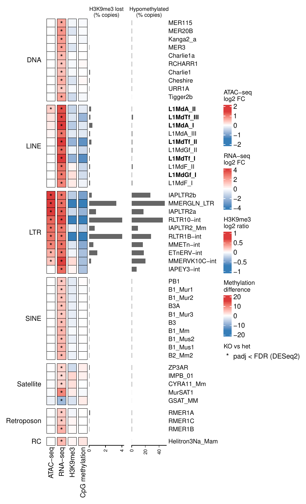
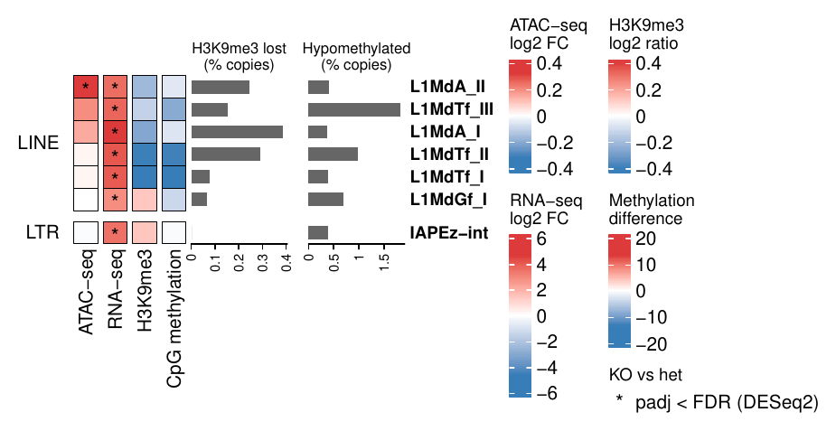
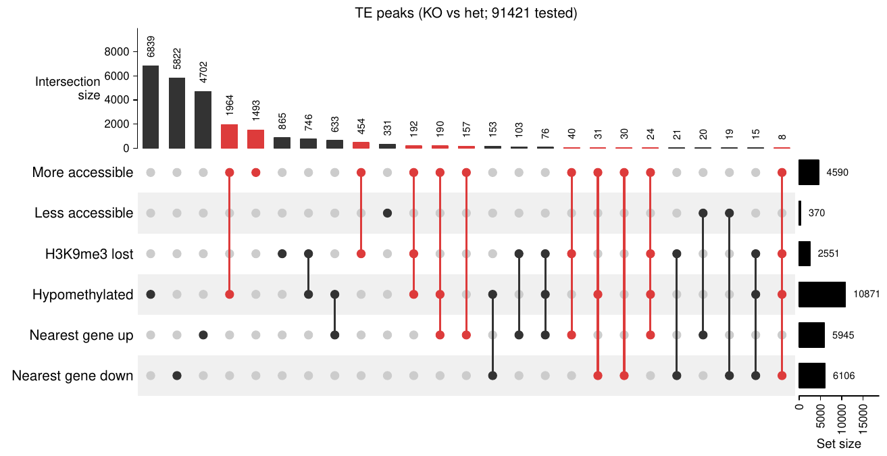
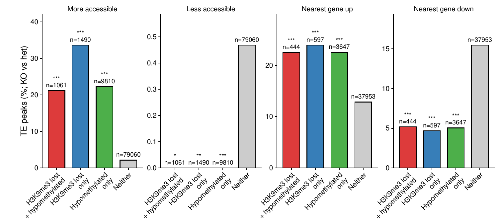
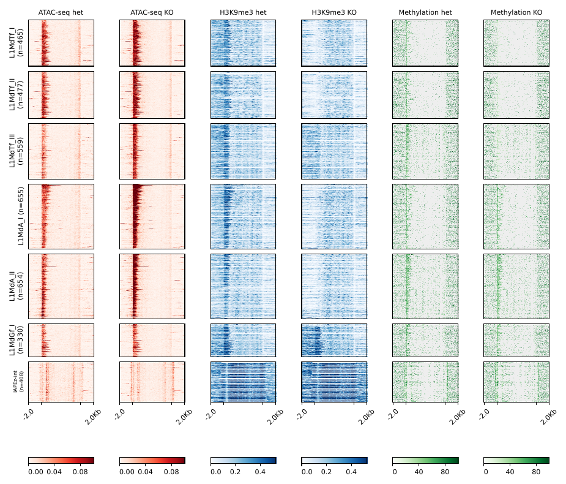
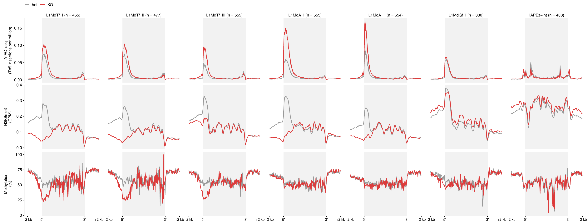

# Integration of all data sets

When a contrast has RNA-seq, H3K9me3 and DNA methylation data, the four data sets can be compared
together. The main question: do the repeats that lose H3K9me3 and DNA methylation open up and get
expressed, and does that happen at the same copies? The pairwise integrations
([RNA-seq](rnaseq_integration.md), [H3K9me3](h3k9me3_integration.md),
[DNA methylation](methylation_integration.md)) each compare one data set with the ATAC-seq data;
this section puts all four side by side at three levels:

- **repeat subfamilies:** heatmaps of the change in accessibility, expression, H3K9me3 and
  methylation of the significant subfamilies and of the `te: profile: subfamilies` entries;
- **TE peaks:** an UpSet plot of the peaks by their changes, and the accessibility and
  expression near the peaks by combination of the marks;
- **full-length copies** of the `te: profile: subfamilies` entries: a heatmap and profiles of the
  signal of ATAC-seq, H3K9me3 and methylation per copy.

## Configuration

```yaml
multiomics:
  enable: true
  min_copies: 20          # significant subfamilies in the heatmap: at least this many copies
  max_per_class: 10       # most significant subfamilies per class in the heatmap
  max_combinations: 25    # largest combinations in the UpSet plot
```

This needs the TE module (`te: enable: true`, also with `te: only`) and `deseq2: enable: true`.
It runs for every DESeq2 contrast that has all of:

- an RNA-seq table in `rnaseq: tables` (with TE rows, e.g. from TEtranscripts, for the
  subfamilies);
- H3K9me3 regions and BigWig files in `h3k9me3: contrasts` (`bigwigs` is required here);
- DMRs and methylation BigWig files in `methylation: contrasts` (`bigwigs` is required here).

With `enable: true` and no such contrast, the workflow stops with an error. The settings of each
data set (thresholds, columns, `rnaseq: distance_bins`) are those of its own section.

## Analyses

### Repeat subfamilies

H3K9me3 and CpG methylation are measured over **all copies** of each subfamily
(`resources/te/repeats.saf`) from the BigWig files of the control and the treatment:

- **H3K9me3:** the summed signal of all bases of the copies divided by their total length (bases
  without signal count as 0), and the change as the log2 ratio of the treatment over the control.
  The pseudocount is 1% of the median signal of the subfamilies.
- **Methylation:** the mean methylation of the CpGs with a value in the copies, and the change as
  the difference of the treatment minus the control (percentage points). Subfamilies without
  covered CpGs are grey.

Two heatmaps, `subfamilies/heatmap.pdf` (significant subfamilies) and
`subfamilies/profile_heatmap.pdf` (profile subfamilies), show four columns, each with its own
colour scale (blue: lower, red: higher in the treatment):

1. ATAC-seq shrunken log2 fold change (DESeq2 of the insertions in all copies,
   [Transposable elements](transposable_elements.md));
2. RNA-seq log2 fold change (TE rows of the RNA-seq table);
3. H3K9me3 log2 ratio;
4. methylation difference.

A star marks a significant change in accessibility or expression (`padj` below the `fdr` of each
data set). The bars on the right give the percentage of copies with at least half their length
in the regions where each mark changes (as in the subfamily plots of the H3K9me3 and methylation
integrations).

- `heatmap.pdf`: the subfamilies with at least `min_copies` copies and a significant change in
  accessibility or expression, at most `max_per_class` per class (those with the smallest
  adjusted p-value in either data set first). Profile subfamilies among them are bold.
- `profile_heatmap.pdf` (only with `te: profile: subfamilies`): every subfamily of the
  `te: profile: subfamilies` entries, whether it changes or not, also if it has no full-length
  copies or is not tested in one of the data sets (missing values are grey). `family:` and
  `class:` entries are left out, as they have too many subfamilies.

In both, rows are split by class and sorted by the ATAC-seq fold change.

### TE peaks

Each TE peak tested by DESeq2 gets:

- its change in accessibility (more, less accessible or unchanged);
- the change of each mark in the region it overlaps most (from the H3K9me3 and methylation
  integrations);
- the differential expression of the gene of its nearest TSS, if that gene was tested in the
  RNA-seq data and the TSS is within the largest `rnaseq: distance_bins` (100 kb by default).

`peaks/upset.pdf` is an UpSet plot ([ComplexHeatmap](https://doi.org/10.1093/bioinformatics/btw313))
of the peaks in the sets more and less accessible, each change of the marks (e.g. H3K9me3 lost,
hypomethylated), and nearest gene up- or downregulated. Each peak is counted in exactly one
combination (the bar above it); peaks in no set are not shown. Combinations with more accessible
peaks are red. Only the `max_combinations` largest combinations are plotted; `peaks/peaks.tsv`
has all peaks.

`peaks/enrichment.pdf` groups the peaks by the first change of each mark (the decrease, e.g.
H3K9me3 lost, if the data have both directions): both marks change, only one, or neither. For
each group it shows the percentage of peaks that are more or less accessible, and of the peaks
with a tested gene, the percentage whose gene is up- or downregulated. Each group is compared
with the peaks without either selected change ("Neither"; with data of both directions, this
includes peaks where a mark changes in the other direction) (Fisher's exact test,
Benjamini–Hochberg adjusted over all tests; `ns`, `*` < 0.05, `**` < 0.01, `***` < 0.001). Each
test compares one group with "Neither"; the groups with both marks and with one mark are not
tested against each other, so compare their percentages descriptively.

### Full-length copies

For the full-length copies of the `te: profile: subfamilies` entries (as in the
[TE profile](transposable_elements.md)), `copies/heatmap.pdf` shows the signal of the control and
the treatment of ATAC-seq (Tn5 insertions, TE signal tracks), H3K9me3 and CpG methylation, one
group of rows per entry. Copies are scaled to `te: profile: body_length` bp, 5' to 3' from left
to right, with `te: profile: flank` bp on each side. Methylation bins without a CpG are light
grey (missing); for ATAC-seq and H3K9me3, missing bins are 0. Each data set has its own colour
scale (from 0 to the 98th percentile of its bins; methylation 0 to 100%, the BigWig files must
be in %), shared by the control
and the treatment.

Within each group, the copies are sorted by the log2 ratio of their mean ATAC-seq signal in the
treatment over the control, most gained accessibility at the top. So a band of copies that open
up can be compared directly with their H3K9me3 and methylation in the columns next to them.

`copies/profile.pdf` shows the mean signal of each group (columns) and data set (rows), control
in grey and treatment in red. The y-axis titles give the units: ATAC-seq Tn5 insertions per million
(as in the other profiles; with `te: bigwig_normalisation: deseq2`, scaled with the DESeq2 size
factors of the TE consensus peaks, labelled "Tn5 insertions per million (DESeq2)"), H3K9me3
`h3k9me3: bigwig_units` (e.g. CPM; `signal` by default) and methylation %.

## Output

In `results/te/integration/multiomics/{contrast}/`:

| File | Content |
| ---- | ------- |
| `subfamilies/signal.tsv` | per subfamily: copies, bp, H3K9me3 and methylation of the control and the treatment (`*_covered_bp`: bases with a value) |
| `subfamilies/subfamilies.tsv` | per subfamily tested in ATAC-seq and RNA-seq: the four changes, `percent_copies_{mark}_{change}`, `profile` (a `te: profile` subfamily), `in_heatmap` (in `heatmap.pdf`) |
| `subfamilies/heatmap.pdf` | heatmap of the four changes of the significant subfamilies |
| `subfamilies/profile_heatmap.pdf` | the same for the `te: profile: subfamilies` subfamilies |
| `peaks/peaks.tsv` | per tested TE peak: accessibility, `h3k9me3_change`, `methylation_change`, nearest tested gene and its `rna_change`, `mark_group` |
| `peaks/upset.pdf` | UpSet plot of the peak sets |
| `peaks/enrichment.tsv`, `peaks/enrichment.pdf` | percentages and Fisher's exact tests by combination of the marks |
| `copies/copies.tsv` | per full-length copy: mean signal of each data set over the copy body, `atac_log2ratio`, the change of each mark and the accessibility (TE peaks) |
| `copies/matrix.gz` | computeMatrix matrix of the six BigWig files (copies in the order of the heatmap) |
| `copies/heatmap.pdf`, `copies/profile.tsv`, `copies/profile.pdf` | heatmap and mean profiles |

`subfamilies/profile_heatmap.pdf` and the `copies/` files are made only with
`te: profile: subfamilies`.

## Example: Morc1 knockout gonocytes

These figures combine the four Morc1 data sets of the other examples for the contrast
`KO_vs_het`: ATAC-seq ([Transposable elements](transposable_elements.md#example-morc1-knockout-gonocytes)),
RNA-seq ([RNA-seq](rnaseq_integration.md#example-morc1-knockout-gonocytes)), H3K9me3
([H3K9me3](h3k9me3_integration.md#example-morc1-knockout-gonocytes)) and DNA methylation
([DNA methylation](methylation_integration.md#example-morc1-knockout-gonocytes)), with the default
settings:

```yaml
multiomics:
  enable: true
```

### Morc1: repeat subfamilies



**Significant subfamilies** (`subfamilies/heatmap.pdf`): 788 subfamilies with at least 20 copies
change significantly in accessibility or expression, and the heatmap shows the 10 most significant
of each class. The LTR retrotransposons (IAPLTR2, MMERGLN, RLTR10, RLTR1B and others) open,
are expressed more, are hypomethylated and mostly lose H3K9me3, and many of their copies are in
the regions where the marks change (bars). The young L1s (bold: profile subfamilies) are strongly
upregulated and lose H3K9me3 and methylation over all their copies, but their accessibility over
all copies changes little (only L1MdA_II is significant). The DNA transposons, SINEs and satellites
are upregulated in the RNA-seq data, with little change in the other data sets.



**Profile subfamilies** (`subfamilies/profile_heatmap.pdf`): the same for the
`te: profile: subfamilies` subfamilies. All are upregulated in the RNA-seq data. Over all their
copies, L1MdTf_I and L1MdTf_II lose the most H3K9me3 (log2 ratio −0.4) and methylation (about
−13 percentage points), the L1MdA subfamilies lose less H3K9me3 (−0.2 to −0.3) and hardly any
methylation (about −2.5 points), and L1MdGf_I and `IAPEz-int` don't lose H3K9me3. Only a small
percentage of their copies is in the regions where the marks change (bars), as these regions
are mostly at the 5' end of the few full-length copies.

### Morc1: TE peaks



**UpSet plot** (`peaks/upset.pdf`): of the 91,421 tested TE peaks, the largest groups change in
only one data set (hypomethylated, or near an up- or downregulated gene). The largest groups of
more accessible peaks (red) are those that are also hypomethylated (1,964), more accessible only
(1,493), and also in a region that loses H3K9me3 (454).



**Enrichment** (`peaks/enrichment.pdf`): 21–34% of the peaks where H3K9me3 is lost, methylation
is lost, or both, are more accessible, against 2.1% of the other peaks. None of them is less
accessible. Their nearest genes are more often upregulated (22–24%, against 13%) and less often
downregulated (5%, against 15%). Peaks with both changes are not more often more accessible than
peaks with one (21% against 34% and 22%); this comparison is not tested.

### Morc1: full-length copies



**Heatmap of the copies** (`copies/heatmap.pdf`): ATAC-seq, H3K9me3 and CpG methylation over each
full-length copy of the profile subfamilies, heterozygous and knockout, sorted by the gain of
accessibility. The 5' UTR of most L1MdTf and L1MdA copies opens in the knockout and loses its
H3K9me3, while the L1MdGf_I and `IAPEz-int` copies keep their H3K9me3.



**Mean profiles** (`copies/profile.pdf`): the mean of the heatmap per subfamily (heterozygous in
grey, knockout in red). In the heterozygous gonocytes, the 5' UTR of the L1MdTf and L1MdA copies
has a peak of H3K9me3, which is gone in the knockout, where accessibility at the 5' UTR rises. The
L1MdTf copies also lose methylation over the 5' UTR (from about 50% to 25–30%), but the L1MdA
copies do not. L1MdGf_I and `IAPEz-int` keep their H3K9me3, and their accessibility and methylation
change little.

## Caveats

- **Repeats and mappability:** the H3K9me3 and methylation signal of young repeats depends on how
  multimapping reads were handled in those data sets. Averaged over all copies of a subfamily,
  multimappers placed at a random copy are no problem, but per copy (`copies/`) the signal of
  young elements is less reliable.
- **Per-subfamily averages:** the H3K9me3 and methylation changes average over all copies, most
  of which are old and truncated. A change at the few full-length copies can be diluted; the
  `copies/` heatmap and the bars of the percentage of copies in the changed regions show those.
- **Scales:** H3K9me3 log2 ratios depend on the normalisation of the BigWig files (e.g. CPM); a
  global difference between the samples shifts all subfamilies.
- **One direction only:** with BED files of regions that change in one direction (e.g. H3K9me3
  lost), the other direction is not available, and the enrichment groups use that direction.
