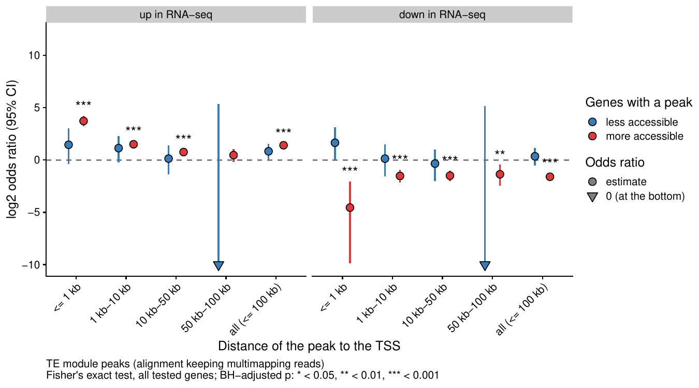
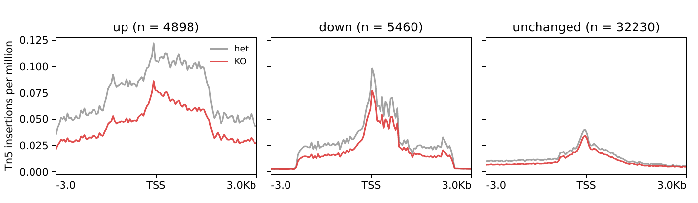
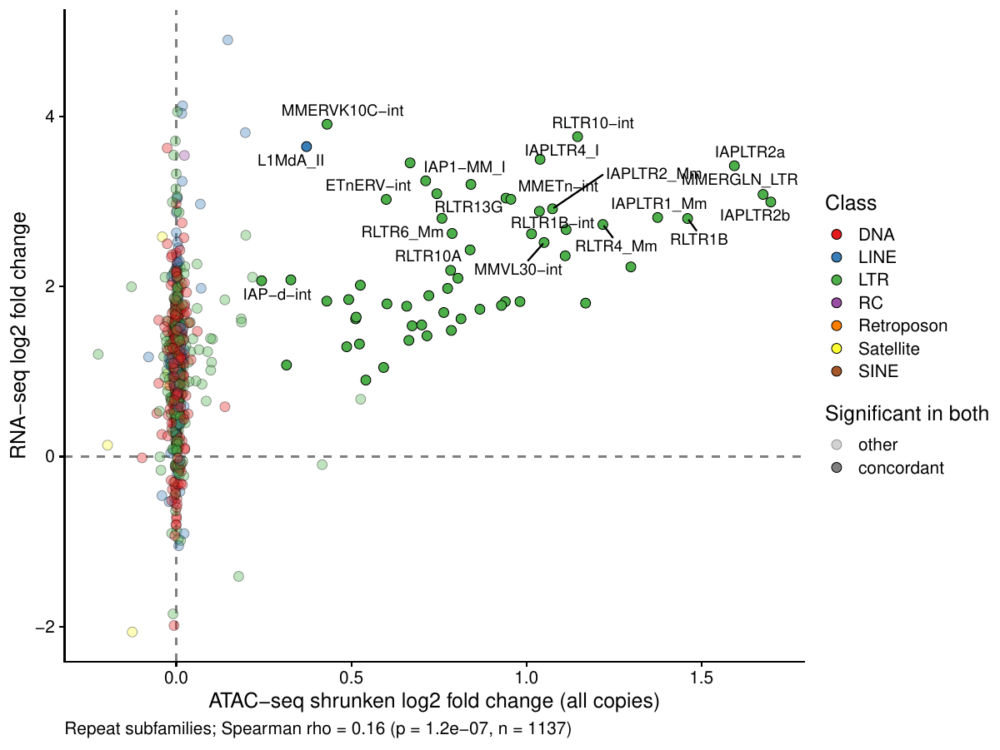

# Integration with RNA-seq

The differential accessibility of a contrast can be compared with RNA-seq differential expression
of the same contrast: are upregulated genes more accessible, and downregulated genes less? This
needs `deseq2: enable: true` and an RNA-seq DESeq2 results table per contrast in
`rnaseq: tables`. It runs for the ENCODE consensus peaks and, with `te: enable: true`, separately
for the peaks of the TE module and the repeat subfamilies (also with `te: only: true`).

The RNA-seq rows are used in two separate groups:

- **Genes (non-TE):** compared with the peaks near their TSS. Without `te: only`, with the
  ENCODE consensus peaks (uniquely mapped reads); with the TE module, also with the peaks of the
  TE module. These are genome-wide peaks of the alignment that keeps multimapping reads, not
  only peaks on TEs (most are at promoters or outside repeats), so they cover genes as well.
- **TE subfamilies:** compared with the accessibility of the subfamily (all copies) and of the
  peaks overlapping it.

## Configuration

```yaml
rnaseq:
  tables:
    # DESeq2 contrast of this workflow ({treatment}_vs_{control}): RNA-seq table
    ko_vs_wt: /path/to/rnaseq/ko_vs_wt_deseq2.tsv
    # or several tables, e.g. genes and TEs in separate files (combined)
    # ko_vs_wt: [/path/to/ko_vs_wt_genes.csv, /path/to/ko_vs_wt_te.csv]
  columns:
    gene_id: ""              # "": the first column (row names written by write.csv)
    log2fc: log2FoldChange
    padj: padj
    base_mean: baseMean
  id_type: auto              # ensembl, symbol or auto
  te_separator: ":"
  fdr: 0.05
  lfc_threshold: 0
  distance_bins: [1000, 10000, 50000, 100000]
  pair_lfc_threshold: 1
  tss_profile_flank: 3000    # TE module: TSS profile, bp on each side
```

- **Tables:** tab-separated, or comma-separated if the name ends in `.csv` (or `.csv.gz`), e.g.
  `write.csv(as.data.frame(res), "ko_vs_wt_deseq2.csv")`. The RNA-seq contrast must have the same
  direction as the ATAC-seq contrast (treatment over control).
- **Genes:** rows are matched to the genes of the workflow's genome annotation (Ensembl GTF), by
  gene ID (a version suffix such as `.5` is removed) or by gene name (names that belong to more
  than one gene are not used). With `id_type: auto`, whichever matches more rows is used. The
  RNA-seq data should use the same genome and preferably the same Ensembl release.
- **TEs** (TE module only): rows whose ID, up to the first `te_separator`, is a RepeatMasker
  subfamily, e.g. `L1MdTf_I:L1:LINE` as written by
  [TEtranscripts](https://doi.org/10.1093/bioinformatics/btv422) and TEcount, or `L1MdTf_I`. A
  table can have both genes and TEs, or they can be in separate tables (a list of paths, with the
  same columns). Gene rows are only used for the peak figures, TE rows only for the subfamily
  figures. Locus-level tables (one row per copy) are not supported.
- Rows that match no gene or subfamily are left out and listed in
  `logs/integration/rnaseq_prepare_{contrast}.log` (`logs/te/integration/` with `te: only`), with
  the numbers of matched rows. Check this log first if the results look empty. A gene or subfamily that is in the table more than once
  keeps the row with the lowest `padj`.
- Genes and subfamilies with `padj < fdr` and `|log2FoldChange| > lfc_threshold` are up- or
  downregulated. Rows without `padj` (not tested, e.g. removed by the independent filtering of
  DESeq2) are left out of all tests, so the background is the genes that could have been called
  differential.

## Genes and peaks

Each consensus peak (or TE peak) is assigned to the gene of its nearest TSS
([ChIPseeker](https://doi.org/10.1093/bioinformatics/btv145) annotation in
`differential_peaks.tsv`), if that TSS is at most the largest of `distance_bins` away. Per tested
gene, the peaks are summarised as:

| `atac_status`     | the gene has                                    |
| ----------------- | ----------------------------------------------- |
| `more accessible` | at least one more accessible peak, no less accessible peak |
| `less accessible` | at least one less accessible peak, no more accessible peak |
| `both`            | more and less accessible peaks                  |
| `unchanged`       | only peaks that do not change                   |
| `no peak`         | no assigned peak                                |

The analyses:

1. **Peak-gene pairs with a significant change in both** (`pairs.tsv`): pairs of a peak and its
   gene where the peak is differential (padj < `deseq2: fdr`) and the gene up- or downregulated
   (padj < `rnaseq: fdr`), both with |log2 fold change| > `pair_lfc_threshold` (default 1;
   shrunken log2 fold change for the peaks). Each pair is *concordant up* (more accessible, up),
   *concordant down* (less accessible, down), *more accessible, down* or *less accessible, up*.
   The larger of the two adjusted p-values (`padj_both`) is a p-value for a change in both
   (intersection-union test, [Berger 1982](https://doi.org/10.1080/00401706.1982.10487790)); the
   product of the two, used in some tutorials, is not a p-value. Two plots show the pairs:
   - **Scatter** (`scatter.pdf`): peak against gene log2 fold change, with Spearman's rho.
   - **Distance** (`distance.pdf`): the distances of the peaks to the TSS, per category: are
     concordant pairs more common at promoters? This shows where the pairs are, not whether
     they are more common than expected; that is the enrichment test below.
2. **Enrichment** (`enrichment.tsv`, `enrichment.pdf`): Fisher's exact tests of whether
   upregulated genes have more accessible peaks more often than the other tested genes (and up
   with less accessible, down with more and with less accessible), per distance bin and for all
   distances. Concordant changes are usually strongest at promoters and weaker for distal peaks,
   which are often assigned to the wrong gene. p-values are adjusted (Benjamini-Hochberg) over all
   tests of a contrast.
3. **TSS profile** (TE module, `genes/tss_profile.pdf`): Tn5 insertions per million (mean of the
   replicates of each condition, the CPM signal tracks of the TE module) within
   `tss_profile_flank` of the TSS of the up-, down- and unchanged genes of the RNA-seq data, one
   panel per group, with the two conditions of the contrast as lines (deepTools computeMatrix
   reference-point and plotProfile). If accessibility follows expression, the treatment line is
   above the control line at upregulated genes and below it at downregulated genes; the unchanged
   genes show differences that apply to all genes (e.g. normalisation or composition). The TSS
   BED files of the groups and the deepTools matrix are next to it.
4. **Correlation** (`correlation.tsv`): Spearman correlation of the shrunken log2 fold change of
   each peak and the log2 fold change of its gene, per distance bin, for all peaks and for
   differential peaks only. Genome-wide correlations are typically weak (rho of about 0.1 to
   0.3), as many changes in accessibility do not change expression (e.g. poised enhancers) and
   many changes in expression do not need a change in accessibility.

## Repeat subfamilies (TE module)

The TE rows of the RNA-seq table are compared with two measures of the accessibility of each
subfamily:

- the DESeq2 test of the insertions in all its copies (`te/deseq2/{contrast}/differential_subfamilies.tsv`)
- the differential TE peaks whose largest repeat overlap is a copy of the subfamily
  (`te_peak_status`, as `atac_status` above)

The output has the correlation of the subfamily log2 fold changes (all subfamilies and per class),
the cumulative distributions of the RNA-seq log2 fold changes per accessibility group (Wilcoxon
tests against unchanged subfamilies: a curve to the right of that of the unchanged subfamilies
means higher expression) and Fisher's exact tests. With a few hundred subfamilies,
these tests have less power than those of the genes.

## Output

In `results/integration/rna-seq/{contrast}/` (genes against the ENCODE consensus peaks),
`results/te/integration/rna-seq/{contrast}/genes/` (genes against the peaks of the TE module) and
`results/te/integration/rna-seq/{contrast}/subfamilies/` (TE subfamilies):

| file                    | content                                                         |
| ----------------------- | --------------------------------------------------------------- |
| `genes.tsv`             | per tested gene: RNA-seq results, numbers of assigned, more and less accessible peaks, `atac_status`, the most significant peak (ID, distance to the TSS, shrunken log2 fold change, `padj`) and `concordance` (`concordant`: up with a more accessible peak or down with a less accessible peak; `discordant`: the opposite) |
| `concordant_genes.tsv`  | the concordant genes, by RNA-seq `padj`                         |
| `enrichment.tsv`, `enrichment.pdf` | Fisher's exact tests per distance bin: numbers of genes, fractions of the up- or downregulated and the other genes with a differential peak, odds ratio with 95% confidence interval, p and adjusted p. Tests without up- or downregulated genes or without genes with a differential peak are NA and not plotted; odds ratios of infinity or 0 (no genes in one cell of the table) are drawn as triangles at the top or bottom of the plot |
| `correlation.tsv`       | Spearman correlation per distance bin, of all and of the differential peaks |
| `pairs.tsv`             | peak-gene pairs with a significant change in both: peak and gene, distance to the TSS, both log2 fold changes and adjusted p-values, `category`, `combined_score` (product of the log2 fold changes) and `padj_both` (the larger adjusted p-value) |
| `scatter.pdf`, `distance.pdf` | plots of these pairs (see above)                    |
| `tss_profile.pdf`, `tss_profile.matrix.gz`, `tss_{up,down,unchanged}.bed` | TE module (`genes/`): Tn5 insertions per million around the TSS of the up-, down- and unchanged genes, with the deepTools matrix and the TSS of each group |
| `subfamilies/subfamilies.tsv` | per subfamily tested in both: ATAC-seq (`atac_*`) and RNA-seq (`rna_*`) results, numbers of TE peaks and `concordance` |
| `subfamilies/correlation.tsv`, `scatter.pdf`, `cdf.pdf`, `cdf_tests.tsv`, `enrichment.tsv` | correlation, scatter plot, cumulative distributions of the RNA-seq log2 fold changes per accessibility group with Wilcoxon tests, and Fisher's exact tests, for the subfamilies |

`rnaseq_table.tsv` in `results/integration/rna-seq/{contrast}/` (in
`results/te/integration/rna-seq/{contrast}/` with `te: only`, so that all output is in
`results/te/`) has the matched genes and subfamilies of the
RNA-seq table, with their up- or downregulation.
`input_tables/` next to it has unchanged copies of the RNA-seq tables of `rnaseq: tables`, so
the results keep the input they were made from.

## Example: Morc1 knockout gonocytes

These figures come from the public ATAC-seq and RNA-seq data of P0 *Morc1* knockout and
heterozygous gonocytes (Uneme et al., 2024; GEO
[GSE235429](https://www.ncbi.nlm.nih.gov/geo/query/acc.cgi?acc=GSE235429)). MORC1 is needed to
silence young transposons in the male germline, so its loss should open and derepress TEs. The
ATAC-seq data (2 knockout, 2 heterozygous replicates) were run with `te: only: true`
(GRCm39, Ensembl 115). The RNA-seq data (3 + 3 replicates) were aligned with STAR to the same
genome and annotation, and genes and TEs were counted with TEtranscripts and tested with DESeq2.
They gave two tables, genes and TEs, both used for the contrast `KO_vs_het`:

```yaml
rnaseq:
  tables:
    KO_vs_het:
      - /path/to/KO_P0_vs_Het_P0_genes.csv
      - /path/to/KO_P0_vs_Het_P0_te.csv
  columns:
    gene_id: ensembl_gene_id
```

All 64,061 gene rows matched a gene ID, and 1,174 of the 1,230 TE rows matched a RepeatMasker
subfamily (`logs/te/integration/rnaseq_prepare_KO_vs_het.log`). DESeq2 tested 42,588 genes
(4,898 up and 5,460 down in the knockout) and 1,139 subfamilies (772 up, 15 down).

### Genes and TE module peaks


**Scatter** (`genes/scatter.pdf`): each point is a peak and the gene of its nearest TSS. Both are
significant, with an absolute log2 fold change above 1. Most pairs (213 of 254) are concordant up:
the knockout opens peaks near genes that it upregulates. Many of these genes are unnamed `Gm`
genes, which may be transcripts that start in derepressed TEs. Only a few peaks lose accessibility, so
there are few pairs on the left. Spearman's rho of the pairs is low (0.08) because the pairs only
measure the direction. How strongly a peak opens does not predict how strongly its gene goes up.


**Distance** (`genes/distance.pdf`): the concordant up pairs are mostly within a few kb of the TSS,
where the nearest-gene assignment is most reliable. The 28 *more accessible, down* pairs are
mostly 5–30 kb or more away, where the peak may control another gene.



**Enrichment** (`genes/enrichment.pdf`): odds ratios (log2, 95% confidence interval) of a
differential peak at up- or downregulated genes, compared with the other tested genes. Within
1 kb of the TSS, 2.0% of the upregulated genes have a more accessible peak, against 0.16% of the
other genes: an odds ratio of 13 (log2 of about 3.7). The enrichment gets smaller with distance.
Downregulated genes have more accessible peaks less often than the other genes, so the effect is
specific to upregulation. The wide intervals for less accessible peaks come from the few such peaks
(19 within 1 kb). The triangles are odds ratios of 0, from bins without any gene that is both
regulated and near a less accessible peak.



**TSS profile** (`genes/tss_profile.pdf`): Tn5 insertions per million around the TSS of each RNA-seq
group, as the mean of the replicates. Upregulated genes have a broad signal (many are in or near
repeats), while downregulated and unchanged genes have a sharp promoter peak. In this data set the
heterozygous signal is higher in all three groups, unchanged genes included. That points to a
difference between the libraries (e.g. in the fraction of reads in open chromatin) rather than in
accessibility. Insertions per million are scaled to the total reads only, unlike DESeq2, which
normalises on the peaks. Compare each group with the unchanged genes, not the two lines directly,
and use the peak tests above for significance.

### Repeat subfamilies



**Scatter** (`subfamilies/scatter.pdf`): each point is a subfamily, with the change in insertions in
all its copies against its change in expression, coloured by class. Subfamilies that are
significant in both are solid and labelled (the largest changes). Those that open and are
derepressed are almost all LTR retrotransposons: IAP (IAPLTR1/2, IAPLTR4_I, IAP-d-int), MMERGLN,
RLTR and MMERVK10C, with L1MdA_II as the LINE. Most subfamilies have no change in accessibility
(an ATAC-seq log2 fold change near 0) but still vary in expression. Spearman's rho is 0.16 for all
subfamilies, 0.20 for LTRs and 0.21 for LINEs (`subfamilies/correlation.tsv`).


**Cumulative distributions** (`subfamilies/cdf.pdf`): the RNA-seq log2 fold changes of the
subfamilies, by accessibility. On the left this is the test of all copies, and on the right the
differential TE peaks in the subfamily. A curve to the right means higher expression in the
knockout. The 59 subfamilies that are more accessible over all copies have a median log2 fold
change of 2.1, against 1.1 for the unchanged ones (Wilcoxon padj < 1e-20). 57 of the 59 are
upregulated (Fisher's exact test: odds ratio 15). Subfamilies with more accessible TE peaks, or
with both more and less accessible peaks, are also shifted to the right. Those with only less
accessible peaks are not.

Even the unchanged subfamilies have a median RNA-seq log2 fold change of about 1 (two-thirds of the
tested subfamilies are up). This may be widespread derepression in the knockout, or come from the
normalisation of the TE counts in the RNA-seq analysis. Either way, the comparison between the
accessibility groups does not depend on it.

## Caveats

- **Nearest gene:** assigning a peak to the nearest TSS is right for most promoter peaks but
  often wrong for distal peaks, whose target genes can be hundreds of kb away. Use the distance
  bins to see where the relationship holds.
- **Fold changes:** the scatter plots and correlations use the shrunken ATAC-seq log2 fold
  changes, the RNA-seq log2 fold changes as given in the table (use shrunken ones there too, if
  available).
- **Same samples:** the analysis compares fold changes, so the RNA-seq and ATAC-seq data do not
  have to come from the same samples, but should be from the same conditions.
- **TEs:** the RNA-seq TE counts depend on how multimapping reads were assigned (e.g. the EM
  algorithm of TEtranscripts), as do the ATAC-seq subfamily counts (see
  [Transposable elements](transposable_elements.md#caveats)).
